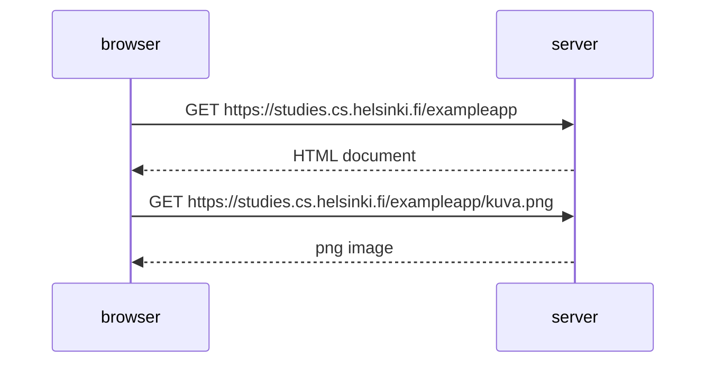
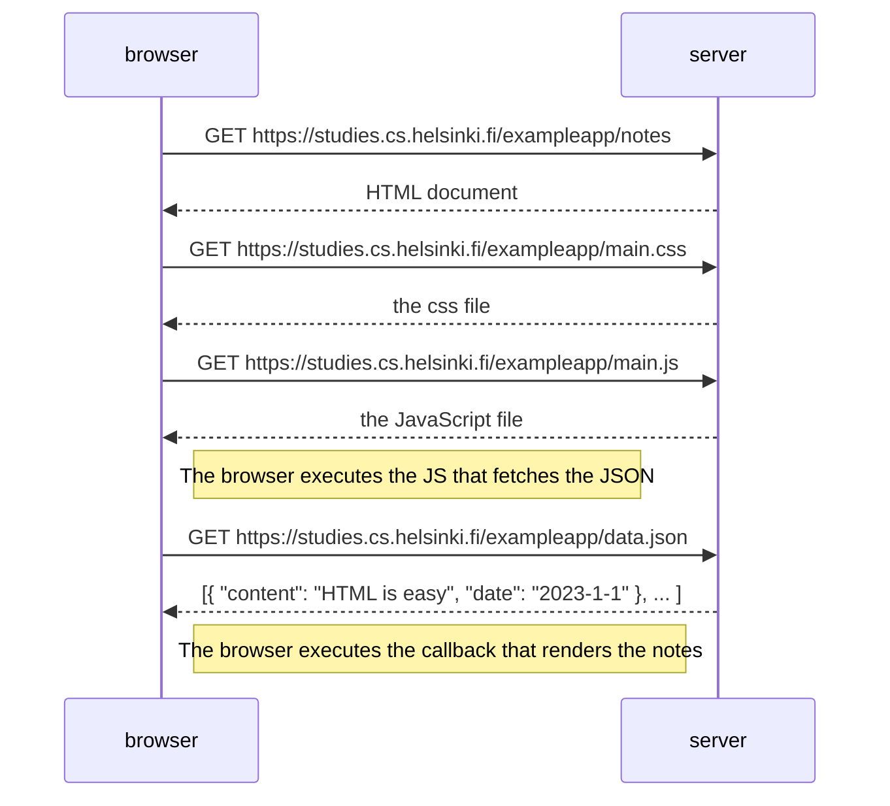

- Source: [Fundamentals of Web Apps](https://fullstackopen.com/en/part0/fundamentals_of_web_apps)
- Example application: `https://studies.cs.helsinki.fi/exampleapp`
- Always keep the browser Developer Console open while developing: `fn-F12` or `option-cmd-i` on macOS.

## HTTP GET

- The browser and the server communicate with each other using the [[HTTP]] protocol. The **Network** tab in the dev tools shows this communication.
- Reloading the example page causes two events:
  - The browser sends a `GET` request to `https://studies.cs.helsinki.fi/exampleapp` and the server responds with status code `200` and the [[HTML]] content (`Content-Type: text/html; charset=utf-8`).
  - The `img` tag in the HTML causes the browser to send a second `GET` request to fetch the image `kuva.png`.



## Traditional Web Applications

- In a traditional web application, the server generates the [[HTML]] dynamically and the browser simply renders it.

```js
const getFrontPageHtml = (noteCount) => {
  return `
    <!DOCTYPE html>
    <html>
      <body>
        <div class='container'>
          <h1>Full stack example app</h1>
          <p>number of notes created ${noteCount}</p>
          <a href='/notes'>notes</a>
          
        </div>
      </body>
    </html>
  `;
};

app.get("/", (req, res) => {
  const page = getFrontPageHtml(notes.length);
  res.send(page);
});
```

- Here the browser is "dumb": it only fetches HTML data from the server and all of the application logic lives on the server.
- Such servers can be built with Java Spring, Python Flask, Ruby on Rails etc. The course uses [[Node.js]] with [[Express]].

## Running Application Logic in the Browser

- Visiting `/exampleapp/notes` triggers 4 HTTP requests. The HTML document has no notes in it; instead it has a `script` tag which loads `main.js`:

```js
var xhttp = new XMLHttpRequest();

xhttp.onreadystatechange = function () {
  if (this.readyState == 4 && this.status == 200) {
    const data = JSON.parse(this.responseText);
    console.log(data);

    var ul = document.createElement("ul");
    ul.setAttribute("class", "notes");

    data.forEach(function (note) {
      var li = document.createElement("li");
      ul.appendChild(li);
      li.appendChild(document.createTextNode(note.content));
    });

    document.getElementById("notes").appendChild(ul);
  }
};

xhttp.open("GET", "/data.json", true);
xhttp.send();
```

- The code uses `XMLHttpRequest` to fetch the notes as [[JSON]] from `/data.json`, then builds a `ul` list of notes and adds it to the page.

> [!NOTE]
> `XMLHttpRequest` is old-school. Nowadays we'd use `fetch` which is [[Promise]]-based. It's used here purely for pedagogical reasons.

## Event Handlers and Callback Functions

```js
xhttp.onreadystatechange = function () {
  // ...
};
```

- This registers an **event handler** for the `onreadystatechange` event. Whenever the state of the `xhttp` object changes, the browser calls this function.
- The function checks that `readyState == 4` (the operation is complete) and the HTTP status is `200`.
- Functions like these are called **callback functions**: the application code doesn't invoke them itself, the runtime environment (the browser) invokes them at the appropriate time, i.e. when the event occurs.

## Document Object Model (DOM)

- [[HTML]] pages can be thought of as implicit tree structures:

```
html
  head
    link
    script
  body
    div
      h1
      div
        ul
          li
          li
          li
      form
        input
        input
```

- The [[DOM]] (Document Object Model) is an API which enables programmatic modification of the element trees corresponding to web pages.
- The `main.js` code above used the DOM-API to build and attach the list of notes:

```js
var ul = document.createElement("ul");

data.forEach(function (note) {
  var li = document.createElement("li");
  ul.appendChild(li);
  li.appendChild(document.createTextNode(note.content));
});

document.getElementById("notes").appendChild(ul);
```

## Manipulating the Document Object from Console

- The topmost node of the DOM tree is the `document` object. We can manipulate it straight from the console:

```js
list = document.getElementsByTagName("ul")[0];
newElement = document.createElement("li");
newElement.textContent = "Page manipulation from console is easy";
list.appendChild(newElement);
```

> [!NOTE]
> Changes made through the console are not permanent. They disappear on page reload since nothing was pushed to the server.

## CSS

- The `head` of the HTML contains a `link` tag which loads the stylesheet `main.css`. [[CSS]] (Cascading Style Sheets) is used to define the appearance of the page.

```css
.container {
  padding: 10px;
  border: 1px solid;
}

.notes {
  color: blue;
}
```

- Class selectors start with a `.` and match elements with that `class` attribute, e.g. `<div class="container">`.
- The **Elements** tab shows the CSS rules applied to an element. We can edit them there too, but again the changes aren't permanent.

## Loading a Page Containing JavaScript - Review

1. The browser fetches the HTML of the page with an HTTP `GET` request.
2. The `link` tag makes the browser fetch the stylesheet `main.css`.
3. The `script` tag makes the browser fetch `main.js`.
4. The browser executes the [[JavaScript]], which makes an HTTP `GET` request to `/data.json` and gets the notes as [[JSON]].
5. When the data arrives, the browser executes the event handler (callback) which renders the notes to the page using the DOM-API.



## Forms and HTTP POST

- The notes page has a `form` element. Submitting it causes 5 HTTP requests. The first one is an HTTP `POST` to `/exampleapp/new_note`.
- The server responds with status code `302`, a URL redirect. The `Location` header tells the browser to do a new `GET` to `/notes`, so the page reloads and fetches `main.css`, `main.js` and `data.json` again.
- The `action` and `method` attributes of the `form` element define that submitting the form is done as an HTTP `POST` to `/new_note`.
- The server-side code handling the `POST`:

```js
app.post("/new_note", (req, res) => {
  notes.push({
    content: req.body.note,
    date: new Date(),
  });

  return res.redirect("/notes");
});
```

- The form data is sent in the body of the `POST` request. The server reads it from `req.body`, creates a note object and pushes it to the `notes` array.

## AJAX

- [[AJAX]] (Asynchronous JavaScript and XML) was introduced in February 2005. It describes fetching content to web pages using [[JavaScript]] embedded in the HTML, without needing to re-render the whole page.
- The notes page uses AJAX to fetch the notes, but still uses the traditional form submission to add a note.
- The URLs used (`/data.json` and `/new_note`) don't follow today's [[REST|RESTful]] API conventions.

## Single Page App

- In a [[Single Page Application|SPA]] (Single Page Application), there's only one HTML page fetched from the server, and its contents are manipulated with [[JavaScript]] running in the browser.
- The SPA version lives at `/exampleapp/spa`. Its `form` has no `action` or `method` attributes. Instead, `spa.js` registers an event handler for form submission:

```js
var form = document.getElementById("notes_form");
form.onsubmit = function (e) {
  e.preventDefault();

  var note = {
    content: e.target.elements[0].value,
    date: new Date(),
  };

  notes.push(note);
  e.target.elements[0].value = "";
  redrawNotes();
  sendToServer(note);
};
```

- `e.preventDefault()` prevents the default form submission (which would send a `POST` and reload the page).
- The handler creates the note, adds it to the notes list, re-renders the list and sends the note to the server:

```js
var sendToServer = function (note) {
  var xhttpForPost = new XMLHttpRequest();
  // ...

  xhttpForPost.open("POST", "/new_note_spa", true);
  xhttpForPost.setRequestHeader("Content-type", "application/json");
  xhttpForPost.send(JSON.stringify(note));
};
```

- The `POST` to `/new_note_spa` sends the note as [[JSON]] with the header `Content-type: application/json` so the server knows how to parse it.
- The server responds with `201 Created` and no redirect, so the browser stays on the same page and sends no further requests.

## JavaScript Libraries

- Vanilla [[JavaScript]] with just the DOM-API is cumbersome, so libraries took over:
  - **jQuery**: popular for its cross-browser compatibility, less relevant today.
  - **BackboneJS** and **AngularJS**: dominated the early SPA era.
  - **Angular 2** (announced October 2014) broke backwards compatibility with AngularJS, which hurt its adoption.
- Currently [[React.js]] is the most popular library for implementing browser-side logic, often used together with a state management library like [[Zustand]]. [[Vue.js]] is a strong competitor.

## Full-Stack Web Development

- A full-stack application has multiple layers:
  - **Frontend**: the browser and the [[JavaScript]] running in it.
  - **Backend**: the server.
  - **Database**: below the server.
- The course uses [[Node.js]] for the backend, so the whole stack is [[JavaScript]].
- A full-stack developer is proficient across all layers (frontend, backend, database) and often handles deployment and infrastructure too.

## JavaScript Fatigue

- Full-stack development is challenging:
  - Things happen in many places at once (browser, server, database) and debugging is harder than in desktop apps.
  - [[JavaScript]] runs in an asynchronous environment.
  - Requires knowledge of [[HTTP]], databases, server administration and [[CSS]].
- The JavaScript ecosystem evolves so fast (tools, libraries, the language itself) that it causes **JavaScript fatigue**.
